# 👋 Hi, I'm Kaan Irmak

### Software Engineer | Fullstack Developer | AI/ML Engineer | Cybersecurity & FinTech

I’m a Software Engineer focused on **Artificial Intelligence, Machine Learning, Cybersecurity, and Financial Technology**. I enjoy building practical, secure, and scalable software solutions — from intelligent data-driven systems to enterprise-grade AI applications.

- 🔭 Working on AI-powered financial systems and secure software architectures
- 🤖 Interested in LLMs, RAG, ML/DL, and intelligent automation
- 🔐 Exploring cybersecurity, anomaly detection, and DevSecOps
- 📈 Interested in algorithmic trading, market intelligence, and financial technologies
- 🌱 Continuously learning, building, and experimenting with new technologies

---

## 🛠️ Tech Stack

  

### AI / Machine Learning
`PyTorch` · `Scikit-learn` · `Pandas` · `NumPy` · `LLMs` · `RAG` · `LangChain` · `LangGraph` · `FAISS`

### Cybersecurity
`Network Security` · `Anomaly Detection` · `Nmap` · `Wireshark` · `Kali Linux` · `Secure Software Development`

### Backend & Infrastructure
`Python` · `C#` · `.NET` · `FastAPI` · `REST APIs` · `Docker` · `GitHub Actions` · `SQL`

---

## 📊 GitHub Statistics

  
  

  

  

  

---

## 🚀 Featured Projects

### 🧠 FinoraAI — Secure Financial AI Assistant
An AI assistant concept designed for financial institutions, combining LLMs and Retrieval-Augmented Generation (RAG) with access controls and security-focused architecture.

**Focus:** LLMs · RAG · Python · FastAPI · FAISS · LangGraph · RBAC

### 🌱 AgroSense / FilizAI — AI-Powered Precision Agriculture
An intelligent agriculture project combining AI-driven crop analysis, sensor data, and location-aware insights to support more informed agricultural decisions.

**Focus:** AI/ML · Computer Vision · IoT · Flutter · .NET · Python · GIS

### 🔐 Cybersecurity & Anomaly Detection
Research and development involving network traffic analysis, machine learning, and anomaly detection for identifying potentially suspicious activity.

**Focus:** Cybersecurity · Python · Machine Learning · Network Analysis · CIC-IDS2017

---

## 📈 What I'm Interested In

- Building secure and production-ready AI applications
- Developing LLM-powered systems with privacy and access control in mind
- Applying machine learning to financial markets and cybersecurity
- Designing reliable APIs, backend services, and automated workflows
- Exploring the intersection of AI, finance, and security

---

## 🤝 Connect With Me

  
  

  <i>Building at the intersection of AI, cybersecurity, and financial technology.</i>

